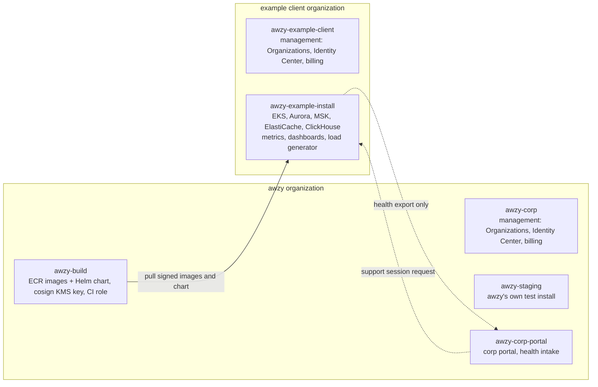

# awzy deployment plan

How the first real deployment is laid out: two separate AWS organizations, one for awzy and one standing in for a client. The example client is installed exactly the way a real client would be, and it is where scale and performance tests run.

## Summary

In AWS, an organization is anchored to the account that creates it, so one account can't start two separate organizations. The plan uses two new AWS accounts, each the management account of its own organization:

| Account | Role | Later |
| --- | --- | --- |
| awzy-corp | Management account of awzy's own organization: build, registry, staging, corp portal | Create member accounts (build, staging, corp portal) inside it, and keep the management account itself nearly empty |
| awzy-example-client | Management account of an organization that stands in for a client's cloud | Create one member account for the install, the way a client would give awzy a dedicated account |

Keeping them as separate organizations tests the product properly. The example client has no trust relationship with awzy at all, so image pulls, the install, health export, and support access all have to work across organizations, as they will for real clients.

> **Performance is monitored in the example client's account, not in awzy's.** That is where a real client's data and metrics stay. Detailed metrics, traces, and load-test results live in the example client's install account. The corp portal sees only the fixed-schema health export, and part of each test is checking whether that export would have been enough for awzy support. See [Performance testing](#performance-testing).

## Accounts



| Organization | Account | Holds | Who signs in |
| --- | --- | --- | --- |
| awzy | awzy-corp | Management account: Organizations, consolidated billing, budgets, Terraform state for `deploy/terraform/corp/`. No workloads. Identity Center is run from the AWS-created Identity Delegated Admin account | You, as awzy admin |
| awzy | awzy-build | ECR repositories for every image and the Helm chart, the cosign signing key in KMS, the GitHub Actions OIDC role | CI; you for setup |
| awzy | awzy-staging | awzy's own install, used before a release reaches `fast` | You, as awzy admin |
| awzy | awzy-corp-portal | Corp portal backend, frontend, and MCP server; health intake endpoint; install registry | awzy staff |
| example client | awzy-example-client | Organizations, IAM Identity Center, billing, budgets. No workloads | You, acting as the client's admin |
| example client | awzy-example-install | The awzy install and everything it needs, plus its monitoring and the load generator | You, acting as the client's platform team |

> **One change from the original two-account sketch.** The sketch had installs go straight into `awzy-example-client`. This plan adds a member account, `awzy-example-install`, for two reasons. Service control policies don't apply to a management account, so an install there would never meet the restrictions a real client's organization puts on awzy. And a real client gives awzy a dedicated account, not their management account. It costs one extra account and nothing else.

## Crossing the boundary

Everything that crosses between the two organizations is listed here. Anything not on this list is a bug.

| What crosses | Direction | How |
| --- | --- | --- |
| Container images and the Helm chart | Client pulls from awzy | ECR repository policies in `awzy-build` grant pull to the install account's ID, and nothing else. Argo CD in the install pulls the chart (an OCI artifact in ECR), and the nodes pull images by digest. Mirroring into the client's own ECR is tested later as a second step |
| Signature verification | None at runtime | The cosign public key is an input to `bootstrap`, which writes it into the Kyverno policy. Kyverno verifies signatures without calling awzy's KMS |
| Health metrics | Client pushes to awzy | The install's OpenTelemetry collector sends the fixed health schema over HTTPS to the corp portal's intake, with a per-install credential issued at registration. Outbound only |
| Support sessions | awzy staff into the client portal | Staff request a session in the corp portal. A client admin approves it in the client portal, which then accepts that staff member's vendor-IdP login for a time-boxed, read-only role. No IAM role in the client account trusts awzy |
| Terraform state | Never crosses | Each organization keeps its own state bucket. awzy never holds a client's state |
| CI | Never crosses | GitHub Actions assumes a role in `awzy-build` only. Nothing in CI can reach the example client |

## Terraform layout

This extends `deploy/terraform/` from the [platform plan](platform-plan.md#getting-into-a-client-account) with a `corp/` tree for the awzy side. A client runs two layers ([ADR 0015](../adr/0015-cloud-agnostic-install.md)): `aws/` creates the AWS infrastructure and outputs `install_contract`, and the cloud-agnostic `bootstrap/` installs Argo CD on top of it. The example client is just one caller of both.

```
deploy/terraform/
├── corp/                        # awzy side; run with --profile awzy-corp and member-account roles
│   ├── state/                   # S3 state bucket in the management account (bootstrap)
│   ├── org/                     # member accounts; later SCPs, RCPs, Identity Center assignments, budgets
│   ├── build/                   # ECR repos + repository policies, cosign KMS key, GitHub OIDC role
│   ├── staging/                 # awzy's own install (calls ../../aws/install and ../../bootstrap)
│   └── corp-portal/             # corp portal, health intake endpoint
├── aws/                         # what a client runs on AWS; nothing here knows about awzy's accounts
│   ├── state/                   # state bucket and lock table in the client's account
│   ├── install/                 # VPC, EKS, Aurora, MSK, ElastiCache, S3, KMS, IAM, ECR pull-through cache;
│   │                            # outputs install_contract
│   └── monitoring/              # optional: managed Prometheus, managed Grafana, OTel collector config
├── bootstrap/                   # cloud-agnostic, helm + kubernetes providers only: Argo CD,
│                                # Kyverno with the cosign policy, root Application fed install_contract
└── examples/
    └── example-client/          # the example client's root config: account IDs, sizes, allowed awzy registry
```

The rule that keeps the test honest: `aws/` and `bootstrap/` may take awzy's registry URL and cosign public key as inputs, but they never reference awzy's accounts, state, or roles. If a client could not run them unchanged, it doesn't belong there. `bootstrap/` also never branches on the cloud, so the same module will run on top of a future `gcp/` or `azure/`.

## Steps

These are the plan and its progress. The commands for an install are in
[INSTALL.md](../../INSTALL.md).

### 1. Create the two accounts

*You, once per account*

1. Before signing up, in Cloudflare: turn on Email Routing for the domain and forward one `aws-<account>@` alias per account to your inbox ([ADR 0018](../adr/0018-awzysecurity-domain-and-dns.md)).
1. Sign up at aws.amazon.com with those addresses as root emails, one per account. Each account needs a payment card. Use "Sign up for AWS (advanced)" if offered. If the account lands in the new projects experience, upgrade to the paid plan and activate advanced features in https://settings.aws.com (Projects, Explore advanced features); without that, Organizations and IAM Identity Center are unavailable ([ADR 0023](../adr/0023-aws-organization-as-built.md)).
1. Turn on MFA for the root user, and don't create root access keys.
1. Open the management account's console from AWS Settings, then in Claude Code run `! aws login --profile awzy-corp --region us-east-2` (and `--profile awzy-example-client`), choosing the management account session.
1. Create a monthly AWS Budget with email alerts. Activation removes the spend limit, so do this first.

**Done when:** both profiles answer a read-only call, and each account has a budget alert. Done on 2026-10-09. `awzy-corp`: budget `awzy-org-monthly`, CLI through `aws login`. `awzy-example-client`: classic "advanced" sign-up, so no projects experience; budget `example-client-org-monthly`, IAM Identity Center in us-east-2 (user `max`, permission set `AdministratorAccess`), CLI through `aws sso login --profile awzy-example-client`.

### 2. awzy organization and build account

*awzy side*

The organization already exists (AWS created it on activation). Apply `deploy/terraform/corp/state` once, then `deploy/terraform/corp/org`, which manages the member accounts `awzy-build`, `awzy-staging`, and `awzy-corp-portal` (see `deploy/terraform/corp/README.md`). New organizations allow only 2 accounts, so request a quota increase first. Delete the detached `BudgetsSpendLimitDeny*` SCPs. In `awzy-build`: ECR repositories, the cosign KMS key, and a GitHub OIDC role scoped to this repository's `main` branch. Add a CI job that pushes each image index and the Helm chart, signed, on every merge to `main`.

**Done when:** a merge to `main` produces signed images in ECR, and the management account still holds no workloads. So far (2026-10-09): `deploy/terraform/corp/build` applied in `awzy-build` (an ECR registry, role `awzy-ci-publish`, key `alias/awzy-cosign`, public key in `deploy/release/cosign.pub`); CI's `publish` job runs `tools/ci/publish-images.sh`. CI's `publish-chart.sh` pushes and signs `deploy/helm/awzy` as `0.1.0-g<sha>` after the images.

### 3. Example client organization and install account

*Example client side*

Activate advanced features as in step 1, request the account quota increase, and create the member account `awzy-example-install`. Apply SCPs that a cautious client commonly uses, such as denying every Region except us-east-2 and denying IAM users with access keys, so the install is tested against them. Run `aws/state`, then `aws/install` through `examples/example-client`.

**Done when:** EKS, Aurora, MSK, ElastiCache, and S3 exist in the install account, and Terraform state lives only in the example client's organization. So far (2026-10-09): `deploy/terraform/examples/example-client/state` (the state bucket) and `.../org`, which created `awzy-example-install`. SCPs on the root deny every Region but us-east-2 (global services excepted) and deny IAM users and access keys. `examples/example-client/install` calls `aws/install`. Applied on 2026-10-10 (88 resources). The first apply failed only at MSK, which runs KRaft on m5 and m7g brokers alone: the `small` profile now runs `kafka.t3.small` brokers on Kafka 3.9 instead. It costs about $250/month while up, so destroy it between test runs.

### 4. First install by pull

*Across the boundary*

The install pulls from `registry.awzysecurity.com` (ADR 0028) with its own pull token, as a real client would: no AWS account grants and no exception in awzy's RCP. Done 2026-10-09: the example install is registered in the corp portal (client `example-client`, environment `demo`, channel `fast`); its install ID, reporting token, and pull token are in the example client's Secrets Manager (`awzy/install-credentials`), which `examples/example-client/bootstrap` reads. Pulling an image, its layers, and the chart through the proxy was checked end to end. Run `bootstrap` through `examples/example-client`, passing it the `install_contract` output of `aws/install`. It installs Argo CD and Kyverno. Argo CD then pulls the chart and signed images from the `fast` channel, and Kyverno rejects anything unsigned.

**Done when:** awzy-pdp answers a check inside the install, an unsigned image is rejected at admission, `bootstrap` contains nothing AWS-specific, and awzy holds no credential for the example client. Done on 2026-10-11 (#97), with `INSTALL.md` run end to end:

- **A check:** awzy-pdp answered `/v1/access/evaluation` through a port-forward, with a service-account token (`"mode":"monitor"`). awzy-gateway also runs the synthetic company's tool calls through it each weekday (`demo_activity`), and those decisions reach ClickHouse through Kafka.
- **Admission:** an image pushed unsigned to a test tag in awzy's registry and pulled through `registry.awzysecurity.com` was refused (`signed-by-awzy-release-key: no signatures found`), as was one from outside the registry. The test tag was deleted.
- **Bootstrap** has no AWS provider and makes no AWS resources. Its one cloud dependency is that Awzy Bot and investigations need Bedrock, so they're on only when the install contract's cloud is `aws`.
- **No credential for the client:** awzy issued the install's pull and reporting tokens, which the client holds; nothing awzy runs can reach into the install.
- **The client portal** signs in at the demo hostname through the dev IdP (`demo_idp`), with Let's Encrypt's certificate. The synthetic company is provisioned over SCIM. A real IdP's sign-in and SCIM are still to be run.
- **Upgrades and rollback under load** (#94): `pdp_loadtest` ran in the cluster at 4 clients while bootstrap moved the install between releases. Rolling back from `c6bcb61` to `c1ec105`, which also left awzy-policy's newer migration `0007` in place under the older release, dropped 1 check in 557,020 (p99 11.4 ms). Upgrading from `c1ec105` to `76bb397`, which crossed #157 (bootstrap and chart together, the policy signing key moving to KMS), dropped 1 check in 653,318 (p99 15.0 ms). Both runs found bugs, now fixed: the demo-data Job's service accounts and tool tiers (#160, #167), releases that couldn't publish (#162, #165), and a bootstrap that couldn't be planned (#163). Bootstrap and the chart move together: from #157, bootstrap no longer makes the `awzy-policy-signing` Secret that earlier charts need, so an install crossing #157 in either direction applies the matching bootstrap and chart.
- **What the first install found**, all fixed: third-party images now carry digests (#88), the ClickHouse operator watches the data namespace (#89), the migrate Job creates its database (#92) and Kafka topics (#136), the released chart pins awzy's image digests so Argo CD sees no drift (#119), and the demo IdP and portal start (#88). The install account needed AWS Support to allow load balancers.

### 5. Monitoring

*Example client side*

Apply `aws/monitoring`: Amazon Managed Service for Prometheus, Amazon Managed Grafana, and the OpenTelemetry collector configuration. Load the dashboards from the repository. Details are in [Performance testing](#performance-testing).

**Done when:** one dashboard shows PDP latency, Valkey, Kafka lag, ClickHouse, and node metrics for the install.

### 6. Corp portal, health export, and a support session

*Across the boundary*

Deploy the corp portal in `awzy-corp-portal`, register the example install, and turn on health export. Run one full support session: request it in the corp portal, approve it in the client portal, use it read-only, and let it expire.

**Done when:** the corp portal shows the example install's health, the client portal shows exactly what was exported, and the support session leaves an audit record on both sides.

### 7. Scale and performance tests

*Example client side*

Seed synthetic data and run the scenarios below.

**Done when:** each scenario has a result written up in the repository, and the platform plan's proposed targets are replaced with measured numbers.

## Performance testing

### Where performance is monitored

Everything is in `awzy-example-install`, the same place a real client would look. In a real install the observability backend is the client's choice. For the example client, the choice is AWS's managed services, so there is little to operate.

| Signal | Source | Stored in | Viewed in |
| --- | --- | --- | --- |
| Server-side latency, throughput, errors | OpenTelemetry metrics from every awzy service (PDP decision histograms, cache hit rates, snapshot size, feed heartbeats) | Amazon Managed Service for Prometheus | Amazon Managed Grafana |
| Client-side latency | k6 load generator, measuring what an enforcement point actually waits for | Same Prometheus workspace, through remote write | Same dashboards, next to the server-side numbers |
| Traces | OpenTelemetry traces, sampled, plus every request slower than the p99 target | AWS X-Ray | Grafana, linked from the latency panels |
| Managed data services | Aurora, MSK, and ElastiCache metrics | CloudWatch | Grafana, through its CloudWatch data source |
| ClickHouse | ClickHouse's Prometheus endpoint and `system` tables | Prometheus | Grafana |
| What awzy support would see | The fixed-schema health export | Corp portal, in `awzy-corp-portal` | Corp portal |

Dashboards and alert rules live in the repository as code, so every install, including staging, gets the same ones.

### Load generator

- **k6**, which speaks gRPC and HTTP, running as Kubernetes Jobs in the install's VPC. That is the network position of a real enforcement point, so the measured latency includes the real network hop.
- It runs on its own `loadgen` node pool, scaled to zero between tests, so it never takes capacity from the PDP.
- Each run writes a summary to an S3 bucket in the install account. A short write-up of the results goes into `docs/perf/` in the repository. That is safe because all the data is synthetic.

### Synthetic data and identities

- The synthetic company in the [demo plan](demo-plan.md) (ADR 0039), `scale` profile: 10,000 people, 500 agents, 1,000,000 resources, and a month of activity, loaded through the same APIs connectors use.
- Load needs many valid tokens, and real IdP logins can't produce them at that rate. The demo IdP (ADR 0032) mints them through client credentials and token exchange. It's a demo-only chart value, so it can never ship to a real client.

### Scenarios

| Scenario | What it measures | Pass condition |
| --- | --- | --- |
| Steady-state checks | PDP throughput and latency with a warm cache | p99 under 10 ms at 1,500 checks/s for 30 minutes, client-side; 5,000/s bursts under 25 ms |
| Cold resources | Checks on resources outside the local cache, so every one goes to Valkey | p99 under 10 ms, and Valkey time within its 3 ms budget |
| Snapshot size | PDP memory, startup time, and feed apply time at 10k and 100k principals | 10k: under 512 MB per pod and 30 s startup; 100k measured |
| Containment propagation | Time from writing a containment to the first deny on every PDP pod, under load | Within the proposed 2 s, or the target is revised |
| Attribute freshness | Time from an attribute change to every PDP snapshot | Within the proposed 60 s, or the target is revised |
| Ingest | Decisions and events per second through Kafka into ClickHouse | 1,500 decisions/s and 3,000 events/s with consumer lag under 60 s |
| Failure drills | ElastiCache failover, PDP pod loss, ClickHouse down then replay from Kafka, PDP unreachable from the enforcement point | Decisions continue as designed, no decision records are lost, and no allow is replayed for a contained principal |
| Upgrade under load | `helm upgrade` to the next release, and a node drain, during steady-state load ([ADR 0072](../adr/0072-deploys-are-zero-downtime.md)) | Zero failed checks and zero failed tool calls |

> **Target load (proposed):** 1,500 checks/s sustained and 5,000/s bursts, sized for 10,000 employees and 500 agents. The reasoning and the full list of targets are in the [demo plan](demo-plan.md#scale-and-performance); revise them with a design partner's numbers.

## Cost control

- A budget alert on each of the two organizations from step 1, before anything else is created.
- The `loadgen` node pool and any scale-test node pools stay at zero between runs. Karpenter scales them up only for a test.
- MSK, Aurora, EKS control planes, and ElastiCache cost money even when idle. Between test periods, the example install can be destroyed and recreated from Terraform. That is also a useful test of the install.
- Managed Grafana charges per active user and managed Prometheus charges per sample ingested. Keep metric cardinality down: no per-principal or per-resource labels. That rule is already in the health export schema.
- Write the measured monthly cost of the idle example install into the platform plan. It is the first real number for the `small` profile.

## Open questions

1. **Target load.** Proposed at 1,500 checks/s sustained (demo plan); confirm or replace it with the first design partner's peak traffic.
1. **Registry mirroring.** Installs pull from `registry.awzysecurity.com` (ADR 0028). Should mirroring into the client's own registry be the default for production installs from the start, since cautious clients will want it?
1. **Support login path.** How does the client portal accept a vendor-IdP login during a session: direct OIDC federation configured per install, or a short-lived guest account in the client's IdP?
1. **Client portal exposure.** For the example client, is the client portal internet-facing behind the client IdP, or reachable only over a VPN?

Companion to the [Awzy Platform Plan](platform-plan.md).

