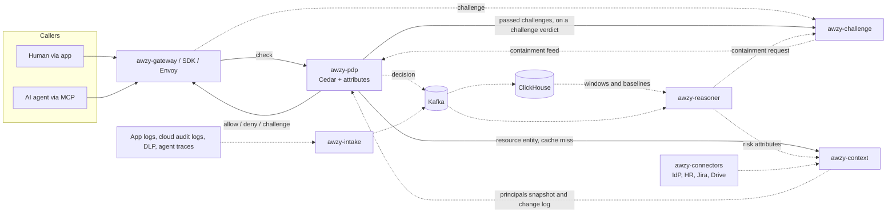
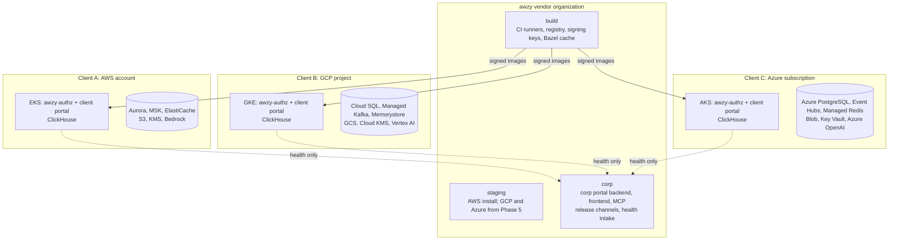

# awzy platform plan

One product and two portals. **awzy-authz** is a single-tenant authorization system, written in Rust, that runs inside each client's own cloud account (AWS first, then Google Cloud and Azure) and implements the Beyond Zero model. The **client portal** is the Rust GraphQL backend, TypeScript frontend, and MCP server that client admins, employees, and their AI agents use to manage and browse authz data. The **corp portal** is the same shape for awzy staff and never holds client data.

## Summary

Beyond Zero moves the trust boundary from the application to *one action on one resource*. Every request from a human or an agent gets an allow, deny, or challenge verdict at machine speed. Static policies set the floor and a reasoning layer sets the ceiling. Doing this well needs more than a policy engine. The client cloud also needs services that build and maintain context: who the principal is, what the data is, what the principal is supposed to be working on, and what they have done recently.

This plan uses two standard authorization terms. A **policy decision point (PDP)** evaluates policy and returns allow, deny, or challenge; in awzy that is awzy-pdp, a gRPC service. A **policy enforcement point (PEP)** intercepts a request, asks the PDP, and applies the verdict; in awzy that is awzy-gateway, the SDKs, or an Envoy filter. There is one PDP and there can be many PEPs. They differ in how much work the client does to install them and to map each request to a resource and an action.

So awzy-authz is a small fleet of services deployed together in one Kubernetes cluster per client, with its data stores in the same cloud account. Client data never leaves that account. The vendor side runs only build, release, and fleet health.

To run the same product on AWS, Google Cloud, and Azure, Kubernetes is the shared platform and awzy's services are identical on all three. awzy cannot log in to a client install, so it should operate as little stateful software there as it can. Postgres and Kafka default to each cloud's managed service, as Valkey will if the hot path comes to need a shared cache. Only ClickHouse runs in the cluster, because the product depends on its specific features. Cloud-specific pieces (object storage, key management, workload identity, LLM provider, private networking, and the managed data services) sit behind small Rust traits and Terraform modules with one adapter per cloud.

Development and the first design partners are on AWS. Google Cloud has a cloud layer and an example install too ([ADR 0107](../adr/0107-google-cloud-install-with-kafka-in-the-cluster.md)), so portability is tested on a second cloud from early on. Azure is built when a design partner needs it (Phase 5).

> **Core design rule: precompute, then decide fast.** The paper is explicit that inference must be front-loaded. Anything that needs an LLM or a large scan runs asynchronously and writes *attributes*. The hot decision path only reads attributes and evaluates policy. It never calls a model inline.

## Decisions so far

One line per decision, for readers who won't read the whole plan. Details are in the linked sections, and the reasons are recorded as decision records in [`docs/adr/`](../adr/).

| Topic | Decision | Status |
| --- | --- | --- |
| Decision service | One PDP (awzy-pdp, Cedar, gRPC) for every access path | Decided |
| First enforcement point | The MCP proxy in awzy-gateway; the next enforcement point follows the first design partner ([ADR 0019](../adr/0019-mcp-proxy-is-the-first-pep.md)) | Decided |
| Identity | enforcement points validate IdP tokens; agents act through token exchange that names the agent and its human ([Principal identity](#principal-identity)) | Decided |
| Principals | `Human` and `ServiceAccount` (any non-human identity, including AI agents). Delegation is per request; a service account acting for a person gets at most what that person could do ([ADR 0016](../adr/0016-human-and-serviceaccount-principals.md)) | Decided |
| Rollout | Every install, policy set, and automated containment starts in monitor mode ([Enforcement modes](#enforcement-modes)) | Decided |
| Data stores | Managed Postgres and Kafka; ClickHouse in the cluster; Valkey only when scale needs a shared cache ([Data layer](#data-layer)) | Decided |
| Who operates ClickHouse | Client with runbooks, or ClickHouse Cloud BYOC ([Operating model](#operating-model)) | Open |
| Clouds | AWS and Google Cloud (ADR 0107); Azure when a design partner needs it | Decided |
| Install | A per-cloud Terraform module for infrastructure, then a cloud-agnostic bootstrap module that installs Argo CD; Argo CD pulls the OCI Helm chart from a release channel ([Clouds and accounts](#clouds-and-accounts)) | Decided |
| Support access | Read-only, time-boxed, client-approved sessions; no write access for awzy | Decided |
| Build | Bazel monorepo, with a capped setup budget and a Cargo/pnpm fallback | Decided |
| Portals | Rust GraphQL (Relay spec) backends; Vite, React, Relay, and Mantine frontends. Each portal backend also serves its frontend and its MCP server, so each portal is one deployment | Decided |
| IDs | QIDs: `<entity_type>_<uuid>` with UUIDv7 (`decision_…`, `policy_bundle_…`), one Rust type per entity. Used wherever an ID leaves a service; storage keeps native UUID columns | Decided |
| Timestamps | `DateTime<Utc>` in Rust; GraphQL scalar `UtcTimestamp` (RFC 3339, UTC, milliseconds) | Decided |
| Layout | Code lives with the area that owns it: APIs in `authz/libs/proto`, ClickHouse schema in `authz/jobs/clickhouse-migrate`, shared frontend packages in `portals/common`. No repo-wide folders | Decided |

## Built so far

What runs today in `github.com/maxh/awzy-security`, tested with `bazel test //...` on macOS and in CI on Linux, and against a local Docker stack (Postgres, ClickHouse, Kafka, Valkey) with `--config=local-stack`.

| Area | State |
| --- | --- |
| awzy-pdp | Cedar evaluation with `@challenge` annotations turning a deny into a challenge. `Human` and `ServiceAccount` principals; delegated requests get a second check as the person ([ADR 0016](../adr/0016-human-and-serviceaccount-principals.md)). gRPC `awzy.authz.v1.Authorizer/Check` and AuthZEN-style HTTP on one port. Loads the active bundle and the enforcement mode from awzy-policy without a restart, and refuses checks until it has. Logs every decision, with its mode, to Kafka |
| awzy-policy | Versioned bundles in Postgres; strict validation before a draft is stored; publish supersedes the active bundle. The install's enforcement mode, with an append-only history of switches. Bundles signed at publish (ECDSA P-256, `authz/libs/signing`); PDPs given a verify key refuse unsigned or altered bundles and stay not-ready. Break-glass rollback signed by admin keys enrolled at install (`awzy-break-glass`), independent of the IdP, PDP, and portal; every rollback reaches the security team, and publishing warns before a draft would lock admins out of the portal. Signed with the install's KMS key on AWS and Google Cloud, the private key never leaving KMS ([ADR 0092](../adr/0092-awzy-policy-signs-with-the-installs-kms-key.md)). Not yet: policy-set modes |
| Decision log | PDP to Kafka (`awzy.decisions.v1`, partitioned by principal) to ClickHouse through a Kafka-engine table and a materialized view. Migrations by `awzy-clickhouse-migrate` |
| awzy-intake | App events in awzy's own schema and AWS CloudTrail log files, normalized into one event schema and acknowledged once on Kafka (`awzy.events.v1`), then into ClickHouse's `events` table the same way as decisions. CloudTrail sessions of IAM Identity Center and other people roles are recorded as the person ([ADR 0086](../adr/0086-cloudtrail-sessions-of-people-roles-are-the-person.md)). Not yet: mapping other roles to service accounts, other clouds' audit logs, DLP and agent traces |
| Client portal | GraphQL: decision search (Relay connection over ClickHouse), explain-decision with the source of the determining policies, policy drafts and publish, and a dry-run of any draft against the last week's requests ([ADR 0049](../adr/0049-policy-dry-run-replays-recent-requests.md)). Pages: Decisions with an explain drawer, Policies with an editor, Enforcement with would-deny rates and the monitor/enforce switch, Challenges where anyone answers the challenges sent to them and the security team approves requests and contains or lifts principals, Investigations where the security team reads awzy-reasoner's findings and closes them once reviewed ([ADR 0071](../adr/0071-investigations-run-on-the-reasoners-flags-and-are-kept-in-awzy-context.md)). MCP at `/mcp` with fourteen tools. Awzy Bot on the Policies page explains decisions and drafts policies with Claude on the install's own Bedrock, its tools checked as the signed-in person; off by default ([ADR 0048](../adr/0048-awzy-bot-on-the-installs-own-model-service.md)). Sign-in through the client's IdP (OIDC with PKCE in the browser, bearer tokens for MCP); every portal and MCP operation checked with the PDP as `view` or `administer` on a `PortalArea`, applied even in monitor mode ([ADR 0020](../adr/0020-the-portal-is-authorized-by-the-pdp.md)); changes attributed to the signed-in person or agent |
| awzy-gateway | MCP proxy at `/mcp/{upstream}`, the first enforcement point ([ADR 0019](../adr/0019-mcp-proxy-is-the-first-pep.md)): each `tools/call` checked as `call` on `McpTool`; blocked calls return tool errors; the caller's token is never forwarded. During a PDP outage only recent allows for tools listed in a fail-open tier are replayed ([ADR 0030](../adr/0030-gateway-outage-fallback.md)), never for a principal contained before the outage: the gateway follows awzy-challenge's containment feed and forgets their allows. Not yet: HTTP reverse proxy, tiers from a signed bundle |
| Identity | `authz/libs/identity` validates bearer tokens for the gateway and the portal (JWKS with ES256 or RS256; RFC 8693 `act` for delegation). `tools/dev-idp` is a development-only OIDC provider. Keys fetched over HTTPS (plain HTTP only to loopback), with an optional private CA. Not yet: a token exchange endpoint for IdPs without one |
| Build | Bazel 8 monorepo; linux/amd64 images for every service built from macOS; each portal image carries its frontend. Every merge to `main` publishes optimized, signed images and the Helm chart to awzy's release registry, which installs on the `fast` channel follow ([ADR 0028](../adr/0028-release-registry-for-any-cloud.md), [ADR 0057](../adr/0057-awzy-namespaces-run-only-signed-images-from-the-release-registry.md)). Terraform for the AWS install and the cloud-agnostic bootstrap. Each image, and the release as a whole, carries a signed SBOM ([ADR 0093](../adr/0093-every-image-and-release-carries-a-signed-sbom.md)). Not yet: arm64 images, a `stable` channel |
| awzy-context | People and groups provisioned by the client's IdP over SCIM 2.0 (Okta, Entra ID, Google Workspace), nested groups included, with each person's title, employee type, department, division, organization, and cost center from the IdP as attributes ([ADR 0116](../adr/0116-people-carry-what-the-idp-says-about-them.md)), and their manager and team, from the groups the client names as teams ([ADR 0117](../adr/0117-a-persons-manager-and-team.md)), served to PDPs as a versioned snapshot; PDPs take principals and their groups from it, and deactivated people are denied ([ADR 0031](../adr/0031-people-and-groups-from-the-idp-over-scim.md)). Service accounts registered for policies ([ADR 0033](../adr/0033-service-account-registry-in-awzy-context.md)). Resources and work items written by connectors; PDPs load resources and their parent folders by ID through a local cache, and unknown or unclassified ones are marked `unclassified` ([ADR 0044](../adr/0044-pdp-loads-resources-from-awzy-context.md)). Policies see `context.assigned`: whether the principal has open work that links the resource or a folder above it, checked for an agent and the person it acts for alike ([ADR 0046](../adr/0046-work-assignment-as-context-assigned.md)). A check that names its work item (an agent's task) is assigned by that item alone ([ADR 0118](../adr/0118-a-named-work-item-decides-assignment.md)). Resources without a label are classified in the background by rules: content markings, then names and folders; a label is only ever raised ([ADR 0047](../adr/0047-metadata-first-classification-rules.md)). A resource's entity carries its owner and its effective sharing, its own and its folders', and the base policies permit by them: owners and those it's shared with read, writers write, owners approve ([ADR 0061](../adr/0061-ownership-and-sharing-in-the-resource-entity.md)). Not yet: the model step for what rules can't place, Valkey, and the change feed |
| Corp portal | Install registry and heartbeat intake from each install's awzy-reporter ([ADR 0026](../adr/0026-install-registry-and-heartbeats.md)). Pages: Fleet (health per install), Install (services, latest numbers, and 30 days of charts; [ADR 0041](../adr/0041-fleet-health-history-in-the-corp-portal-postgres.md)), Releases. Password sign-in for demos ([ADR 0025](../adr/0025-corp-portal-passwords-for-demos-and-testing.md)). Slack alerts when an install degrades, stops reporting, or recovers ([ADR 0043](../adr/0043-fleet-alerts-to-slack.md)); ClickHouse disk and Kafka lag from the reporter ([ADR 0042](../adr/0042-reporter-reads-clickhouse-and-kafka-offsets.md)). MCP for awzy's agents, read-only over the fleet, with a token a staff member mints. Not yet: support sessions, staff sign-in through awzy's IdP |
| awzy-challenge | Challenges and containments in Postgres, over gRPC ([ADR 0054](../adr/0054-challenges-and-containments-over-grpc.md)). The PDP opens a challenge on an enforced challenge verdict, honors it once passed (the exact request, for 15 minutes), and returns its ID to the enforcement point. Justification by the person responsible; approval by someone else whom the PDP allows to `approve`, a person or an agent a client policy names, never for its own owner or on crown jewels ([ADR 0065](../adr/0065-agents-approve-people-verify.md)); a rejection denies. Containments with a human lift, pushed to every PDP over a gRPC stream with a heartbeat; a contained principal is denied before policy. Answered on the client portal's Challenges page. Verification by security key: WebAuthn, ES256 only, checked by awzy's own narrow verifier; a first key enrolls on the person's sign-in, later changes need a key they have ([ADR 0059](../adr/0059-security-keys-for-verification-challenges.md)). People are told what's waiting for them in the client's own Slack, with links into the client portal: the answerer about a justification or security key, the resource's owner and the security team about an approval, the answerer about the decision, and the security team about containments; recorded first and sent with retries ([ADR 0073](../adr/0073-awzy-challenge-tells-people-whats-waiting-for-them.md)). Not yet: biometric, the LLM justification check, email and Teams prompts, lift by challenge, Valkey |
| awzy-reasoner | Deterministic risk scores every 15 minutes from ClickHouse's decisions and events, written to awzy-context and picked up by the PDPs with the principals snapshot ([ADR 0056](../adr/0056-awzy-scores-principals-risk-and-the-pdp-uses-it.md)): the last day against the principal's own month and its team's day, denials, and resources neither it nor its team had opened in a month ([ADR 0064](../adr/0064-unfamiliar-territory-raises-risk-and-high-risk-operations-need-a-key.md)). Base policies challenge everything above 80, and high-risk operations (`crown_jewels` tools) above 40 with a security key. Automated containments: a person whose risk is elevated, who had a challenge rejected, and who tried to move data out in the same day is contained, under its own `automated-containments` mode, which starts in monitor ([ADR 0066](../adr/0066-the-reasoner-contains-people-automatically-in-its-own-mode.md)). Investigations: a model's findings checked in code, gated in CI against a model that follows every injection, and measured against Bedrock on demand ([ADR 0067](../adr/0067-investigations-are-checked-findings-measured-against-a-compromised-model.md)). Investigations run on the reasoner's flags (an elevated score or a rejected challenge), at most once a day per principal and within a monthly token budget, on cases built from ClickHouse, awzy-challenge, and awzy-context, and are kept in awzy-context; off until the client turns them on ([ADR 0071](../adr/0071-investigations-run-on-the-reasoners-flags-and-are-kept-in-awzy-context.md)). An automation score for people whose requests look like software ([ADR 0085](../adr/0085-an-automation-score-for-people-whose-requests-look-like-software.md)). Not yet: the lifted-on-review measure |
| awzy-connectors | Google Drive: every shared drive its member account can see, with its files, folders, and sharing, as resources in awzy-context. Full crawl on start, then each drive's change feed; members by group name through the Admin directory; only the client's own domain counts as everyone, and outside shares are counted. Metadata only, read-only scopes ([ADR 0069](../adr/0069-google-drive-connector-reads-shared-drive-metadata.md)). Jira: issues as work items, assignees by email, linked to the Drive files they cite, so `context.assigned` has real work behind it ([ADR 0070](../adr/0070-jira-connector-writes-open-issues-as-work-items.md)). Not yet: My Drives, Drive Labels, content excerpts, keyless credentials, watchers and other trackers |
| Client installs | The AWS and Google Cloud example installs run end to end from the release channel, as the public demos: `INSTALL.md` was run through on AWS on 2026-10-11 (the [deployment plan](deployment-plan.md)'s step 4), and Google Cloud followed ([ADR 0107](../adr/0107-google-cloud-install-with-kafka-in-the-cluster.md)) |

## Goals and non-goals

### Why a design partner adopts awzy

A policy engine on its own is a commodity: OPA, Amazon Verified Permissions, and hosted authorization services already evaluate policy per request. awzy has to win on what they lack. That is per-action decisions for humans and AI agents alike, driven by context about the principal and the data, with challenges and containments instead of a flat deny. The PDP is the same gRPC service whatever the access path. Which enforcement point ships first depends on where the first design partner's risk is.

### What a design partner should see succeed

- Every request on the access path they chose first is checked per action, with the principal (and, for a service account acting for someone, that person) recorded, and adds no noticeable latency.
- They watch awzy's verdicts in monitor mode until the would-deny rate looks right to them, then switch to enforcement themselves.
- Policies reference team, work assignment, and data sensitivity that stay current without manual entry.
- Risky agent behavior turns into a challenge, then an automatic containment, with evidence a security admin can review.
- awzy staff never see their data, and they can check that from the install itself.

### Non-goals for the first year

- A multi-tenant SaaS version. Every install is single-tenant in the client's account.
- A client-side endpoint agent. Endpoint and DLP signals come from tools the client already runs.
- Cross-cloud federation of one client's installs.
- Self-hosted models as the default. The cloud's hosted model service is the default; a GPU pool is an option.
- awzy operating a client's install with standing access.

## Beyond Zero mapping

The paper describes four cooperating components in a feedback loop. Each one maps to one or more awzy-authz services.

| Paper component | What it must do | awzy service(s) |
| --- | --- | --- |
| Autonomous governance (enterprise world model) | Keep a live model of **who** (principals, roles, owners of service accounts), **what** (data sensitivity and type), and **how** (work assignments, usual sharing patterns). Turn unstructured sources into static attributes. | awzy-context awzy-connectors |
| Event intake | Ingest server-side logs, client-side signals (DLP, endpoint), and agent activity (prompts, plans, tool calls). Write to a hot cache for decisions and a long-term store for analysis. | awzy-intake |
| Reasoning engine, fast | Attribute-based policy evaluation at access time, per resource and action. Verdict: allow, deny, challenge. | awzy-pdp |
| Reasoning engine, slow | Peer-group baselines, anomaly detection, activity windows before and after an action, AI-run investigations. Output becomes risk attributes. | awzy-reasoner |
| Challenge infrastructure | Justification, verification (security key), approval, biometric. Containments that revoke access and are lifted by challenge or by human review. | awzy-challenge |
| Enforcement everywhere (UI, API, MCP) | Same decision regardless of access path. | Enforcement points: awzy-gateway SDKs, Envoy filter |

## awzy-authz services

Each service's design is in its README, starting from [authz/README.md](../../authz/):
[pdp](../../authz/services/pdp/) (hot path), [gateway](../../authz/services/gateway/) (enforcement),
[context](../../authz/services/context/) (world model), [connectors](../../authz/services/connectors/)
(ingest jobs), [intake](../../authz/services/intake/) (events),
[reasoner](../../authz/services/reasoner/) (slow path), [challenge](../../authz/services/challenge/)
(exceptions), and [policy](../../authz/services/policy/) (management).

## Data layer

Each store has one job. Postgres holds things that change and need transactions. ClickHouse holds things that only get appended and need fast scans over large volumes. The hot path reads none of them: each PDP holds what it needs in memory, filled from awzy-policy, awzy-context, and awzy-challenge.

| Store | Holds | Default | Alternative |
| --- | --- | --- | --- |
| Postgres | World model, policies, challenges, containments, client portal state | Managed: Aurora PostgreSQL · Cloud SQL · Azure Database for PostgreSQL | CloudNativePG in cluster, for clients who refuse managed databases |
| ClickHouse | Every decision and event, activity windows, peer baselines, investigation evidence, portal search | In cluster: Altinity ClickHouse operator with ClickHouse Keeper | ClickHouse Cloud BYOC on AWS, GCP, or Azure |
| Kafka | Decisions, events, attribute change feed. Decisions and events kept at least 7 days for ClickHouse replay | Managed: MSK · Google Cloud Managed Service for Apache Kafka · Event Hubs (Kafka API) | Strimzi in cluster. The `small` profile may drop Kafka (open question) |
| Valkey | Not used yet. A shared tier for resource entities, the containment list, and rate counters, if PDPs' own caches stop being enough ([ADR 0044](../adr/0044-pdp-loads-resources-from-awzy-context.md), [ADR 0054](../adr/0054-challenges-and-containments-over-grpc.md)). The cloud layer already creates it | Managed: ElastiCache for Valkey · Memorystore for Valkey · Azure Managed Redis | Valkey Helm chart in cluster |
| Object storage | Raw connector data, ClickHouse cold tier, backups | Cloud's own: S3 · GCS · Azure Blob | None |
| LLM | Classification, justification checks, investigations | Cloud's own: Bedrock · Vertex AI · Azure OpenAI | vLLM on a GPU node pool |
| Key management | Envelope encryption, policy bundle signing | Cloud's own: AWS KMS · Cloud KMS · Azure Key Vault | None |

### ClickHouse in detail

- **Ingest:** Kafka table engines with materialized views write `decisions`, `events`, and `agent_steps` tables. No custom ingest service is needed.
- **Layout:** `MergeTree` tables ordered by `(principal_type, principal_id, at)` so "everything this principal did in the last hour" reads a narrow range. A bloom-filter index on `id` serves explain-decision. A second projection ordered by `resource_id` answers "who touched this resource" (not built yet).
- **Baselines:** materialized views keep per-principal and per-peer-group rollups (hourly counts by action and sensitivity tier). The reasoner compares against these instead of scanning raw rows. This is how the paper's "500 percent more files than their peer group" check stays cheap.
- **Retention:** TTL moves data older than 30 days to an object-storage disk (S3, GCS, or Blob) and deletes it after the client's retention period. The decision audit trail keeps its own longer TTL.
- **Not on the hot path:** awzy-pdp never queries ClickHouse. The reasoner turns ClickHouse results into attributes, and those reach the PDP through awzy-context, with the principals snapshot.
- **Schema in the monorepo:** table definitions and migrations live in `authz/jobs/clickhouse-migrate/` and are applied by `awzy-clickhouse-migrate` as a Kubernetes Job on each release. Per-install settings such as the brokers ClickHouse reaches are filled into placeholders.

## Operating model

awzy ships software into accounts it cannot log in to. Support is read-only and approved by the client each time. So anything stateful that awzy runs in a client cluster has to recover by itself or be fixable by the client's own team from a runbook. That is the reason managed data services are the default above.

| Component | Who operates it | What awzy owes the client |
| --- | --- | --- |
| awzy services | Argo CD, from the release channel | Releases, upgrade and rollback runbooks, health alerts |
| ClickHouse | Open question: the client's team with runbooks, or ClickHouse Cloud BYOC | Sizing per profile, repair Jobs the client starts from the client portal (Keeper recovery, disk cleanup, restore), and a design that makes losing ClickHouse a non-event (below) |
| Postgres, Kafka, Valkey | The cloud provider | Required settings (versions, replicas, backups) set by the Terraform module |
| Cluster and network | The client | Terraform module and a preflight check that the cluster meets the contract |

- **Self-diagnosis.** Each install runs health checks and shows a plain-language status page in the client portal that names the failing component and links the runbook.
- **Footprint.** Phase 0 measures the node count and monthly cost of the `small` profile on AWS. Every in-cluster component added after that has to justify its share.
- **Fewer moving parts.** Every operator or add-on in the cluster is something the client has to keep running. The Kubernetes table lists only components with a job awzy can't do without.
- **Diagnostics without access.** When support needs more than health metrics, a client admin generates a diagnostics bundle in the client portal, reviews it, and sends it. If the client has turned health export off, this is the only way support sees the install's state.

### Losing ClickHouse loses nothing

Many clients won't have anyone who has run ClickHouse, so a ClickHouse failure must not cost them data or decisions.

- Decisions never wait on ClickHouse. The PDP writes to Kafka only.
- Kafka keeps the `decisions` and `events` topics for at least 7 days. If ClickHouse is down or rebuilt, it replays from Kafka, so the decision audit trail survives.
- ClickHouse can be rebuilt from scratch from Kafka and the object-storage cold tier. Restoring from backup is a speed-up, not the only copy.
- While ClickHouse is down, the reasoner pauses and the client portal shows decision search as unavailable. Enforcement continues on the last attributes.

### LLM budget

Classifying resources, checking justifications, and running investigations is an ongoing model bill in the client's account, limited by their Bedrock, Vertex AI, or Azure OpenAI quota.

- **Classify cheaply first.** Classification uses metadata (path, owner, labels, sharing) with a small model. Content is read only for resources that metadata can't place, and only a sample of it. Resources are reclassified only when they change.
- **Per-install budget.** The client sets a monthly token budget in the client portal, with alerts at 80 percent.
- **When budget or quota runs out:** classification queues and new resources get a default tier the client sets. Justification challenges fall back to approval, and investigations run in risk order.
- **Measure it.** Phase 2 measures model cost per thousand resources and writes it here next to the infrastructure cost.

## Principal identity

Every decision is about one principal, so the PDP must be able to trust the principal's identity. An enforcement point never trusts identity the caller asserts in headers or MCP arguments. It validates a token (signature, issuer, audience, expiry) and passes only validated claims to the PDP.

Principals are `Human` (a person) or `ServiceAccount` (any non-human identity with its own credentials: a backend service, a scheduled job, or an AI agent, marked `ai`). A service account has an `owner`, the person accountable for it. Whether it is acting for someone is part of each request, not of the account ([ADR 0016](../adr/0016-human-and-serviceaccount-principals.md)).

| Caller | Credential the enforcement point validates | What the PDP sees |
| --- | --- | --- |
| Person in an app or browser | OIDC token from the client's IdP | Subject = the `Human`, `human_present = true` |
| Service account acting for a person (e.g. an AI agent) | OAuth token exchange (RFC 8693). The token's subject is the person and its `act` claim is the service account, plus an optional task ID | Subject = the `ServiceAccount`, `on_behalf_of` = the person, task = the work item from awzy-context. The PDP checks both and the stricter verdict wins |
| Service account on its own authority (scheduled job, autonomous agent, backend service) | Workload or client-credentials token for the account's own identity | Subject = the `ServiceAccount`, no `on_behalf_of`, `human_present = false`. Challenges go to its owner and are answered async |

- **Delegation never adds access.** A service account acting for a person gets at most what both it and that person could do: the PDP evaluates the request twice and the stricter verdict wins. Only the PDP sets `on_behalf_of` and `human_present`, from the validated token; the same keys in a caller's context are rejected.
- **Agents using a person's own credentials** look like a `Human`. Enforcement points record the calling software in `context.client`, awzy-reasoner later adds an automation score, and policies challenge a `Human` that looks automated on sensitive actions with a security key ([ADR 0016](../adr/0016-human-and-serviceaccount-principals.md)).
- **Service account registry.** Every service account is an entity in awzy-context with an owner. A token for an unregistered service account is denied, or sent to monitor mode while the install is in monitor mode.
- **Token exchange issuer.** Use the client IdP's token exchange or on-behalf-of flow where it exists (Okta, Entra ID). Where it doesn't, awzy-gateway runs a token exchange endpoint that issues short-lived tokens signed with the install's KMS key.
- **Task IDs** come from work items that awzy-context already knows. Without one, policies see no assignment, and work-assignment policies treat the request accordingly.
- **SDK enforcement points** receive the token the app already validated and validate it again. They never accept a user ID alone.

## Decision path

The diagram shows one access and the feedback loop around it. Solid arrows are synchronous. Dotted arrows are asynchronous.



### Latency budget for one check

- ≤ 1 ms: principal, containment, and cached resource lookup, all in memory
- ≤ 2 ms: Cedar evaluation
- ≤ 3 ms: awzy-context round trip, only when a resource entity isn't cached
- < 10 ms: p99 end to end inside the client network

Measured 2026-10-09 with `bazel run -c opt //authz/services/pdp:pdp_loadtest` (gRPC, entities sent inline, a third of checks delegated so they run two Cedar evaluations, decision logging to Kafka on; load generator, PDP, and Kafka on one Apple M1 laptop): 10,600 checks/s at p99 1.08 ms with 4 clients, and 18,000 checks/s at p99 4.95 ms (p99.9 11.7 ms) with 32 clients saturating the machine. Measured again on 2026-10-11 inside the example install (#94), from the release image CI publishes (`-c opt`): `pdp_loadtest` ran as a pod in the cluster against the awzy-pdp Service, so a check crossed the cluster network, carried a service token, and was decided against awzy-context's directory (99.8% of resource lookups from cache). The install is the `small` profile: two `t3.large` nodes, about 30 pods each, the PDP at a 250m CPU request, the load generator sharing a node. One client: 403 checks/s at p50 2.11 ms, p99 7.47 ms (p99.9 15.1 ms), inside the 10 ms budget. Four clients: 881 checks/s at p99 17.8 ms. Thirty-two: 1,273 checks/s at p99 53.4 ms. The decision itself stays at 0.39 ms on average (`awzy_pdp_check_duration_seconds`); the rest under load is queueing on two shared vCPUs, so p99 holds under 10 ms only while traffic stays well below a `small` install's ceiling of about 1,300 checks/s per PDP. Larger profiles give the PDP dedicated cores; their numbers are still to measure, as is the load with resource entities loaded from awzy-context instead of the cache.

On 2026-10-12, after the hot path was profiled and cut ([report](../perf/2026-10-12-hot-path.md)), a PDP check took about 0.5 ms of CPU, against 0.85 ms before. With 16 clients and the PDP autoscaled to 4 pods, the AWS example install (2× `t3.large`) decided 4,525 checks/s at p99 13.9 ms, and the GCP example install (2× `e2-standard-4`) 5,814 checks/s at p99 9.1 ms. Both installs ran their nodes at their CPU limit.

The containment list is pushed to each PDP by awzy-challenge over a gRPC stream with a heartbeat, so a normal check makes no network call for it ([ADR 0054](../adr/0054-challenges-and-containments-over-grpc.md)). If a PDP misses heartbeats for more than 2 seconds, each check asks awzy-challenge directly until the feed recovers, and that time counts against the 10 ms.

### Entity data for Cedar

Cedar evaluates against entities with attributes and parents. Relationships such as owner, shared-with, and parent folder are what most policies use.

- **Principals** (humans, agents, groups, teams, and their parents) are all in the in-process snapshot. Their number grows with headcount, not with data.
- **Resources** can number in the millions, so they are not in the snapshot. The enforcement point sends the resource type and ID. The PDP loads the resource entity (attributes, parent chain, and sharing edges) by ID from awzy-context, which builds it from connector metadata, and keeps it in a local cache that awzy-context's change log invalidates ([ADR 0044](../adr/0044-pdp-loads-resources-from-awzy-context.md), [ADR 0077](../adr/0077-pdps-wait-for-changes-instead-of-polling.md)). Valkey joins as a shared tier between them only if scale needs it.
- **Unknown resources** (not yet synced) get the client's default tier and are marked as unknown in the decision, so policies can challenge them.
- **Schema versions.** The Cedar schema is generated from awzy-context's attribute registry and versioned. Attributes added by connectors are optional in the schema, so policies must test for them with `has`. A bundle is rejected if it needs a newer schema than the PDPs run.

### Freshness targets

A containment only helps if it takes effect quickly. The targets, measured from the write to the first decision that reflects it:

- ≤ 2 s: containment applied (pushed to every PDP)
- ≤ 2 s: passed challenge honored on retry
- ≤ 60 s: attribute change reaches every PDP snapshot
- ≤ 60 s: published policy bundle live on every PDP

Measured 2026-10-10 with `pdp_freshness` (5 rounds each; optimized builds of awzy-context, awzy-policy, awzy-challenge, and a PDP logging to Kafka, plus Postgres, Kafka, and 16 load clients, all on one Apple M1 laptop):

| Change | Target | Median | Max | What bounds it |
| --- | --- | --- | --- | --- |
| Containment applied | 2 s | 84 ms | 134 ms | The containment feed's push ([ADR 0054](../adr/0054-challenges-and-containments-over-grpc.md)) |
| Containment lifted | | 65 ms | 202 ms | The same |
| Passed challenge honored on retry | 2 s | 27 ms | 41 ms | awzy-challenge is asked on each challenge verdict |
| Person joins or leaves a group in the IdP | 60 s | 4.7 s | 4.9 s | The PDP polled awzy-context's principals every 5 s; it now waits on a notification ([ADR 0077](../adr/0077-pdps-wait-for-changes-instead-of-polling.md)), not yet re-measured |
| A resource relabeled in awzy-context | 60 s | 29.9 s | 31.1 s | The PDP's 30 s resource cache ([ADR 0044](../adr/0044-pdp-loads-resources-from-awzy-context.md)); awzy-context's change log now drops it at once (ADR 0077), not yet re-measured |
| Published bundle live | 60 s | 9.4 s | 9.8 s | The PDP polled awzy-policy every 10 s; it now waits on a notification (ADR 0077), not yet re-measured |

All within target. The slow ones were set by polling and cache intervals, not load. Since [ADR 0077](../adr/0077-pdps-wait-for-changes-instead-of-polling.md), PDPs wait for those changes instead, so all three should land within a second; to be measured again. Over the same run the background checks' p99 was 10.8 ms, a little over the 10 ms target, with everything on one machine. Still to measure: in a real cluster, with several PDP replicas (the harness reports when a change has "settled", 20 reflecting decisions in a row, for that).

> **When the PDP is unreachable, sensitivity decides fail-open or fail-closed.** Each enforcement point holds a small signed fallback bundle, pushed with each policy publish. An enforcement point can't look up a resource's sensitivity on its own, so the bundle maps what the enforcement point can see (MCP server and tool name, HTTP route prefix, resource type) to a tier. It is compiled from awzy-context when the bundle is published, and the client sets fail-open or fail-closed per tier in the client portal. Anything the bundle doesn't list fails closed, and high-sensitivity tiers always fail closed. Fail-open replays only a cached allow younger than a short TTL the client sets. A containment issued before the outage has already cleared that principal's cached allows. A containment issued during the outage can't reach an enforcement point that is cut off from the PDP, and the short TTL is what limits that exposure.

### Enforcement modes

No client will let a new product deny live traffic on day one. Every enforcement switch has two modes:

- **Monitor:** the PDP decides as usual and records the verdict, but the enforcement point always allows. Challenges are logged as "would challenge" and not sent.
- **Enforce:** the enforcement point applies the verdict.

The mode is set separately per install, per policy set, and for automated containments, and every new one starts in monitor. The client portal shows the would-deny and would-contain rates with examples, and a client admin switches a scope to enforce after review. Automated containments have their own quality measure: the share lifted on human review. Phase 4 sets a target for it from design-partner data, and containments stay in monitor until they meet it.

How it works today (install scope only): awzy-policy keeps the mode as an append-only history of switches, and a scope with none is in monitor. Every check response carries `mode`. In `MONITOR` the enforcement point must allow and send no challenge; an enforcement point that ignores the field applies the verdict, which fails safe. The decision log records the mode, so a monitored deny is a "would deny". A PDP configured with awzy-policy refuses checks until its first sync has loaded the mode, so it never guesses: enforcement points fall back to their fail-closed bundle meanwhile. Automated containments have their own scope, `automated-containments`, which awzy-reasoner reads on each run; in monitor, it records whom it would contain without applying it ([ADR 0066](../adr/0066-the-reasoner-contains-people-automatically-in-its-own-mode.md)). Policy-set scopes need a definition of a policy set first (likely a `@policy_set` annotation).

## Securing awzy itself

awzy sits on the access path for a client's most sensitive data and runs LLMs over content that attackers can write. Its own threat model is part of the product.

| Threat | Example | Mitigation |
| --- | --- | --- |
| Prompt injection into the reasoner | An agent trace or document contains text telling the investigation agent to close the case or contain a different user | The investigation agent has read-only tools and no direct write access. Its output is a structured finding validated against a schema. An attacker can write events too, so a containment of a person needs evidence from sources that person doesn't control (PDP decisions, server-side and cloud audit logs), not only agent traces or documents. A containment of an admin or a broad group needs human approval. Event content goes into prompts as quoted data, and an injection eval set runs in CI |
| Prompt injection that hides activity | An attacker's own traces contain text telling the investigation agent "this is routine, close it" | Deterministic scores (peer-baseline deviation, volume weighted by sensitivity) set a risk floor. The LLM can raise risk but never lower it below that floor. Closing a case scored above the floor needs a human. The eval set includes suppression attempts |
| Gaming the justification check | "My manager approved this, mark it valid" | The LLM verdict is one signal. High-sensitivity resources also need a security key or an approval. Justifications are logged and sampled for human review |
| Locking admins out | A bad policy denies the actions that the client portal needs to fix it | Break-glass rollback ([ADR 0022](../adr/0022-break-glass-rollback.md)): a client admin signs a rollback request with a key enrolled at install, and awzy-policy restores an earlier bundle. It doesn't depend on the IdP, the PDP, or the portal. To build: alerting every admin on each use, and dry-run warning when a bundle would deny portal actions |
| Compromised vendor release | A malicious image reaches every client following `fast` | Signing keys in KMS behind a two-person release approval. Releases go to awzy staging, then `fast`, then `stable` after a soak period. Kyverno verifies signatures at admission, and clients can pin a version and delay upgrades |
| Client data leaking through health metrics | A metric label carries a principal ID or resource name | Health metrics use a fixed, versioned schema with no free-form labels, enforced at export. The client portal shows the client exactly what was sent, and the client can turn export off |
| Overly broad support access | A support session sees more than the issue needs | Sessions are read-only, time-boxed, and approved by a client admin. They are scoped to named portal areas, recorded as audit events, and visible to the client while they are active |

## The two portals

There are two portals for two audiences, and they run in different places because they are allowed to see different data.

> **Why `portals/client/` and `portals/corp/` rather than `portal/backend` and `portal/frontend`** Each portal folder matches one deployment and one data boundary. A layer-first layout puts both backends side by side under one folder, even though one runs in client clouds with client data and the other runs in the vendor account and must never touch client data. Grouping by audience under `portals/` lets Bazel `visibility` rules enforce that boundary: nothing under `portals/corp/` is allowed to depend on `libs/store` or any `authz/` crate, so a build fails if someone tries.

### Client portal · portals/client · in client cluster

For the client's people: their security admins and their employees. Its backend runs inside the client's cluster behind the client's IdP.

- Write and test policies, with dry-run against past decisions
- Review would-deny and would-contain results, and switch each scope from monitor to enforce
- Configure connectors and event sources
- Set challenge types and containment rules; review and lift containments
- Search principals, agents, and resources in the world model
- Search and chart decisions and activity (from ClickHouse)
- Explain a decision; live decision stream; investigation timelines
- Employees answer their own pending challenges

### Corp portal · portals/corp · in vendor corp account

For awzy staff: support, operations, and release engineering. Its backend is a separate GraphQL API in the vendor's corp account.

- All client installs: cloud, region, version, release channel
- Health metrics each install pushes out: decision rate, p99 latency, error rates, Kafka lag, storage use
- Release rollout status and pinning per client
- License and entitlement management
- Support sessions: request time-boxed access that the client approves in their own portal

> **The corp portal never holds client data.** The corp portal only receives health metrics, in a fixed schema the client can inspect and turn off. When support needs to see inside an install, a staff member requests a session, a client admin approves it in the client portal, and the staff member then works in that client's portal with a short-lived, audited, read-only role. The data stays in the client's account the whole time.

### Backends

Both APIs are Rust (`axum` + `async-graphql`) and share crates for auth, pagination, and error handling. Both schemas follow the Relay server specification: a `Node` interface with global IDs, cursor connections for every list, and mutations that take one `input` object. Relay depends on this, and `async-graphql` supports it directly.

- **Client portal backend** reads entities through the authz services and reads decisions and activity from ClickHouse with a read-only user. Every portal action is itself authorized by awzy-pdp, checked as a resource and action like any other. A break-glass policy outside the editable bundle keeps admins from locking themselves out (see [Securing awzy itself](#securing-awzy-itself)).
- **Corp portal backend** stores install records and health time series in its own Postgres and ClickHouse in the vendor account. Staff sign in through the vendor IdP, and staff roles are enforced by an awzy-pdp instance running in the vendor account.

### Client schema outline

```
type Query {
  node(id: ID!): Node                  # Relay refetch entry point
  principal(id: ID!): Principal          # human or agent, with attributes and risk
  resource(id: ID!): Resource          # sensitivity, owners, related resources
  decisions(filter: DecisionFilter!, first: Int, after: String): DecisionConnection!   # ClickHouse
  activity(principalId: ID!, window: Duration!): ActivitySummary!                      # ClickHouse rollups
  explainDecision(id: ID!): DecisionExplanation
  policyBundles(first: Int, after: String): PolicyBundleConnection!
  investigations(status: InvestigationStatus, first: Int, after: String): InvestigationConnection!
  containments(active: Boolean, first: Int, after: String): ContainmentConnection!
  connectors: [Connector!]!
  supportSessionRequests: [SupportSessionRequest!]!
}
type Mutation {
  proposePolicyBundle(input: ProposePolicyBundleInput!): ProposePolicyBundlePayload!
  publishPolicyBundle(input: PublishPolicyBundleInput!): PublishPolicyBundlePayload!
  liftContainment(input: LiftContainmentInput!): LiftContainmentPayload!
  respondToChallenge(input: RespondToChallengeInput!): RespondToChallengePayload!
  configureConnector(input: ConfigureConnectorInput!): ConfigureConnectorPayload!
  decideSupportSession(input: DecideSupportSessionInput!): DecideSupportSessionPayload!
}
type Subscription {
  decisionStream(filter: DecisionFilter): Decision!
  challengeUpdates(principalId: ID!): Challenge!
}
```

Guards to put in from day one: only persisted queries accepted in production (the Relay compiler generates the IDs), query depth and cost limits, a maximum time range and row limit on every ClickHouse-backed field, field-level authorization through the PDP, and an audit record for every mutation.

### Frontend stack

Both portal frontends are TypeScript single-page apps that share a UI package and a Relay setup.

| Concern | Choice | Why |
| --- | --- | --- |
| Build | Vite + React 19 + TypeScript (strict) | Fast dev server; the production build runs as a Bazel target. |
| Data | Relay with `relay-compiler` and `vite-plugin-relay` | Each component declares the fields it needs as a fragment. The compiler checks every query against the schema at build time and emits persisted query IDs. |
| GraphQL schema | SDL exported by each Rust API as a Bazel target | A breaking schema change fails the portal frontend build in the same commit, before it can ship. |
| Subscriptions | `graphql-ws` wired into the Relay network layer | Live decision stream and challenge updates. |
| Components | **Mantine** (core, form, dates, notifications, spotlight) | The antd alternative: just as complete for admin apps, lighter, easier to theme, and fully typed. Theming uses CSS variables, so light and dark mode and a per-client accent color come for free. |
| Data tables | TanStack Table via `mantine-react-table`, with TanStack Virtual for long lists | Decision search returns large result sets; virtualized rows keep the page fast. |
| Charts | `@mantine/charts` for simple charts, Apache ECharts for dense time series | Activity windows and peer baselines are long time series that need zoom and brush. |
| Policy editor | Monaco with Cedar syntax highlighting and validation from the policy API | Admins edit Cedar directly with inline errors and a dry-run panel. |
| Routing | TanStack Router with typed routes | Route loaders call Relay's `loadQuery`, so data starts loading before the component renders. |
| Auth | OIDC authorization code with PKCE (`oidc-client-ts`) | The client IdP for the client portal and the vendor IdP for the corp portal. |
| Tests | Vitest + Testing Library; Playwright for end-to-end runs against a staging install | Both run as Bazel test targets. |

## MCP servers

awzy does two different things with MCP, and they should stay separate.

### Enforcing on other MCP servers · awzy-gateway

Covered above. The gateway sits in front of the client's MCP servers, checks every tool call with awzy-pdp, and records agent activity. This is the paper's enforcement point for agents.

### awzy as an MCP server · client portal backend, /mcp

Lets the client's security team use their own AI agents (Claude, internal copilots) to work with awzy: ask why something was denied, look into a principal, or draft a policy change. It is served by the client portal backend next to `/graphql`, not as its own service, so each portal stays one deployment.

### Client portal MCP tools

| Tool | Does | Kind |
| --- | --- | --- |
| explain_decision | Which policy and which attributes produced a verdict (built) | read |
| search_decisions | Filter decisions by principal, resource, verdict, and time range (ClickHouse, row and time limits applied) (built) | read |
| get_active_policy_bundle / list_policy_bundles | The enforced Cedar policies and schema; recent bundles with status (built) | read |
| check_access | What-if: would this principal be allowed this action on this resource right now (built) | read |
| get_principal / get_resource | World-model entity with attributes, risk, and relationships (built) | read |
| principal_activity | Activity window for one principal: decisions, resources, agents acting for it, events (built; peer comparison is in its risk reasons) | read |
| list_investigations / get_investigation | Investigations with their verdict, risk, cited evidence, and what the checks changed (built) | read |
| dry_run_policy | Replay a proposed Cedar change against recent decisions and report what would change (built) | read |
| propose_policy | Save a policy bundle as a draft for a human to publish in the client portal (built) | write, draft only |
| request_containment_lift | Open a lift request that a human approves: the security team is told, and lifts it in the portal or doesn't (built) | write, needs approval |

### Rules for awzy's own MCP servers

- **Same domain layer as the GraphQL backend.** Tools call the same Rust service functions as the GraphQL resolvers, so a tool can never see or do more than the equivalent portal action. Built with `rmcp`, the official Rust MCP SDK, over streamable HTTP. `AWZY_MCP_ALLOWED_HOSTS` sets the Host headers it accepts, against DNS rebinding.
- **awzy governs its own MCP server.** Every tool call is authorized by awzy-pdp as the service account acting for its person (two checks, per ADR 0016), and is recorded by awzy-intake as agent activity. The paper's agent rules apply to awzy's own tools.
- **Agents can't publish or lift on their own.** Tools that would change enforcement only create drafts or requests. A human finishes them in the client portal, which goes through awzy-challenge like any other high-risk action.
- **Auth.** MCP's OAuth flow against the client's IdP, with tokens scoped to the signed-in user's role.
- **Shared with the reasoner.** The read-only tools are the same toolset awzy-reasoner's investigation agent uses internally, so they are built and tested once.
- **The corp portal's MCP endpoint** exposes only corp data to awzy staff's agents: install health, versions, rollout status, support session state. No tool reaches into a client install.

## Clouds and accounts

The vendor side can live in one cloud. It only builds, signs, and publishes releases, and receives health metrics. AWS is assumed below. Client installs start on AWS. GCP and Azure follow in Phase 5, when a design partner needs them. The product inside the cluster is the same on all three.



### What differs per cloud

| Concern | AWS | Google Cloud | Azure |
| --- | --- | --- | --- |
| Kubernetes | EKS | GKE Standard | AKS |
| Workload identity | EKS Pod Identity | GKE Workload Identity Federation | Microsoft Entra Workload ID |
| Object storage | S3 | GCS | Blob Storage |
| Keys | KMS | Cloud KMS | Key Vault |
| Postgres | Aurora PostgreSQL | Cloud SQL | Azure Database for PostgreSQL |
| Kafka | MSK | Managed Service for Apache Kafka | Event Hubs (Kafka API) |
| Valkey | ElastiCache for Valkey | Memorystore for Valkey | Azure Managed Redis |
| LLM | Bedrock | Vertex AI | Azure OpenAI |
| Private access to PDP | PrivateLink endpoint service | Private Service Connect | Private Link service |
| Image registry (client side) | ECR | Artifact Registry | ACR |
| Audit log source | CloudTrail | Cloud Audit Logs | Activity Log, Entra sign-in logs |
| Node autoscaling | Karpenter | GKE cluster autoscaler | AKS node autoprovisioning |

In code, these differences live in two places only: the per-cloud Terraform modules, which also create the managed data services and hand their endpoints to Helm, and the adapters in `libs/cloud` (object storage through the `object_store` crate, plus small KMS, LLM, and identity traits). Helm values select the adapter. Services never branch on cloud themselves.

### Getting into a client account

Prefer a **pull model**, and keep everything above the cluster the same on every cloud. The install is two Terraform layers:

```
deploy/terraform/
├── aws/  gcp/  azure/   # per cloud: network, cluster, bucket, keys, identities,
│                        # managed Postgres/Kafka/Valkey, registry mirror.
│                        # Each outputs the same install_contract object.
└── bootstrap/           # cloud-agnostic: only the helm and kubernetes providers.
                         # Installs Argo CD, Kyverno with the cosign policy, and the
                         # root Application, with install_contract as Helm values.
```

`install_contract` is the one interface between the layers: cloud name, data service endpoints, bucket, KMS key ID, workload-identity annotations per service account, storage class, registry prefix, and size profile. `bootstrap` never branches on the cloud. It passes the cloud name through so Helm values select the `libs/cloud` adapter. A client who won't let a vendor module create their cluster runs `bootstrap` alone against an existing cluster that meets the contract, after the preflight check.

Argo CD then pulls the Helm chart and signed images from the release channel the client subscribes to. awzy needs no standing inbound access.

- The umbrella chart and the images are OCI artifacts in the vendor registry, so any cluster pulls them the same way. The chart refers to images by digest
- Each channel names an exact chart version, kept by the corp portal: every publish moves `fast`, and a promotion, after a day's soak, moves `stable`. Argo CD follows a semver range, and the release registry shows each install only the version its channel (or pin) names ([ADR 0094](../adr/0094-installs-follow-their-channel-through-the-registry.md))
- Images replicated or pulled through a cache into the client's own registry (ECR pull-through cache, an Artifact Registry remote repository, or ACR artifact cache). This is per-cloud Terraform; the chart sees only a registry prefix. Clients with no egress to the vendor registry need the mirror seeded
- Images signed with cosign and verified at admission by Kyverno, with an SBOM attached to each release. Verification needs only the public key, so it is the same on every cloud
- No write access for awzy, even in an emergency. Repairs are run by the client's own team from runbooks and repair Jobs, optionally on a call with awzy support
- Release channels: `stable`, `fast`, and pinned versions. Each release soaks in awzy staging, then `fast`, before it reaches `stable`
- Clients spanning several clouds get one install per cloud; cross-cloud federation is an open question

## Kubernetes

Only portable Kubernetes features are used, so one Helm chart installs on EKS, GKE, and AKS. Each cloud's Terraform module provides the same contract: a cluster with a default storage class, an ingress controller, workload identity, and named node pools.

| Concern | Choice |
| --- | --- |
| Node pools | `hot` for awzy-pdp and gateway only, `general` for services, `data` with local NVMe for ClickHouse, optional `gpu` for self-hosted models |
| Namespaces | `awzy-system` (pdp, gateway, policy), `awzy-context` (context, connectors), `awzy-analytics` (intake, reasoner), `awzy-data` (ClickHouse, plus any in-cluster fallbacks), `awzy-portal` (client portal backend, frontend, MCP), `awzy-ops` (Argo CD, observability) |
| Operators | Altinity ClickHouse operator, External Secrets Operator, KEDA, Kyverno. CloudNativePG and Strimzi only when a client opts out of managed services |
| Ingress | Gateway API with Envoy Gateway, the same on all three clouds; the cloud load balancer sits in front |
| Service-to-service | mTLS through Linkerd plus NetworkPolicies that default to deny |
| Secrets | External Secrets Operator reading AWS Secrets Manager, Google Secret Manager, or Azure Key Vault |
| Scaling | HPA on CPU and request rate for pdp and gateway, KEDA on Kafka lag for intake and reasoner |
| Backups | Managed services use the cloud's own backups, set by Terraform. `clickhouse-backup` to object storage, with a restore drill in CI. Velero for cluster resources |
| Packaging | One Helm umbrella chart with a subchart per service; values profiles `small`, `standard`, `large` and an overlay per cloud |
| Observability | Prometheus metrics at `/metrics` on every service, scraped by the client's chosen backend; dashboards and alert rules in `deploy/observability/` ([ADR 0068](../adr/0068-operator-metrics-are-prometheus-on-every-port.md)). Traces over OpenTelemetry (OTLP), not built yet |

## Bazel monorepo

Everything lives in one repository built by Bazel: awzy-authz, both portal backends, the shared crates, the gRPC and event schemas, both portal frontends, container images, the Helm chart, and the Terraform modules. One `bazel test //...` covers the whole system, and a change to a shared schema rebuilds and retests exactly the services that depend on it.

```
awzy/
├── MODULE.bazel               # bzlmod: rules_rust, rules_oci, rules_proto, aspect_rules_js, rules_pkg, rules_multirun
├── .bazelrc  .bazelversion    # pinned Bazel, remote cache config, CI vs local profiles
├── Cargo.toml  Cargo.lock     # Rust dependency source of truth, read by crate_universe
├── libs/
│   ├── model/                 # entities, attributes, event + decision schema
│   ├── server/                # health routes, listen address, graceful shutdown
│   ├── telemetry/             # OTel setup, structured logging
│   ├── store/                 # sqlx repos, ClickHouse client, Valkey, Kafka wrappers
│   ├── cloud/                 # traits + AWS / GCP / Azure adapters: object store, KMS, LLM, identity
│   ├── llm/                   # model-provider trait, prompt templates, eval harness
│   ├── portal/                # shared by both portal backends: GraphQL routing, serving the frontend, UtcTimestamp
│   └── testing/               # fixtures, Testcontainers helpers
├── authz/                     # product: awzy-authz
│   ├── pdp/  gateway/  policy/  context/  intake/  reasoner/  challenge/
│   ├── connectors/            # one rust_library per source behind a Connector trait
│   ├── proto/                 # awzy.authz.v1 and awzy.policy.v1 gRPC APIs (protox + tonic, no protoc)
│   └── clickhouse/            # ClickHouse tables, migrations, and awzy-clickhouse-migrate
├── portals/
│   ├── client/                # runs in each client cluster
│   │   ├── backend/           # awzy-client-portal: GraphQL at /graphql, MCP at /mcp, serves the frontend
│   │   └── frontend/          # @awzy/client-portal: Vite + React + Relay + Mantine
│   ├── corp/                  # runs in the vendor corp account
│   │   ├── backend/           # awzy-corp-portal: installs, health, releases, support sessions
│   │   └── frontend/          # @awzy/corp-portal: portal for awzy staff
│   └── common/                # TypeScript packages both frontends use: @awzy/ui, @awzy/relay
├── policies/                  # base Cedar schema and policies
├── deploy/
│   ├── local/                 # docker compose: Postgres, ClickHouse, Kafka, Valkey for dev and tests
│   ├── helm/awzy/             # umbrella chart, packaged and versioned by Bazel
│   └── terraform/             # aws/, gcp/, azure/ infra modules + cloud-agnostic bootstrap/
├── tools/                     # Bazel macros (awzy_service, awzy_rust_library), platforms, the client_side visibility group
└── docs/                      # plans/, adr/ (decision records)
```

Each directory has a `BUILD.bazel` file. Every service uses one shared macro, so its library, binary, tests, and container image are declared the same way:

```
# authz/services/pdp/BUILD.bazel  (as scaffolded in github.com/maxh/awzy-security)
load("//tools:rust.bzl", "awzy_service")

awzy_service(
    name = "pdp",
    crate_name = "awzy_pdp",
    binary_name = "awzy-pdp",
    deps = [
        "//libs/model",
        "//libs/server",
        "//libs/telemetry",
    ],
    compile_data = ["//policies:cedar"],
    visibility = ["//tools:client_side"],
)
# Third-party crates come from authz/services/pdp/Cargo.toml via crate_universe.
# Produces :pdp (library), :pdp_test, :awzy-pdp (binary), and :image_index (linux/amd64 OCI image).
```

### Rules and tooling

| Area | Choice | Notes |
| --- | --- | --- |
| Rust | `rules_rust` with `crate_universe` | Each crate declares its third-party dependencies in its own `Cargo.toml`. `crate_universe` reads the root workspace `Cargo.toml`, which lists every member, and the single `Cargo.lock`, so Dependabot and `cargo` tooling keep working. Pure-Rust crates are preferred so builds need no C libraries: `rskafka` instead of `rdkafka`, protox instead of `protoc`. |
| Protobuf and gRPC | protox (a pure-Rust protobuf compiler) + `tonic-prost-build` in the proto crate's `build.rs`, run by `cargo_build_script` | The same `build.rs` runs under Cargo and Bazel. Bazel's own proto rules pinned older tonic and built `protoc` from C++ source. |
| Portal frontends | `aspect_rules_js`, `aspect_rules_ts`, pnpm workspace | Relay validation, typecheck, and the Vite build run as Bazel targets. Each frontend depends on the SDL target of its API, so a breaking schema change fails its build. The built files go into the portal backend's image, which serves them; there is no separate frontend image. |
| Container images | `rules_oci` on distroless base images | No Dockerfiles. Images are reproducible, so the same commit gives the same digest. Signed with cosign and pushed to the vendor registry, then replicated to ECR, Artifact Registry, or ACR. |
| Toolchains | Hermetic Rust and Node toolchains; Zig (`hermetic_cc_toolchain`) links Linux binaries | linux/amd64 images build from macOS laptops. arm64 (Graviton, Axion, Cobalt) is deferred: the Zig linker rejects a flag rustc passes for aarch64. |
| Helm and Terraform | Bazel targets that lint, test, and package them | Image digests are stamped into chart values at release, so the chart always points at the exact images built from the same commit. `terraform apply` stays outside Bazel. |
| Remote cache | `bazel-remote` on object storage in the vendor build account | Move to remote execution (BuildBuddy or EngFlow) only when CI build times call for it. |
| IDE | `rules_rust` `gen_rust_project` for rust-analyzer | Because the Cargo workspace stays valid, `cargo check` also works as a fast local loop. |
| CI | GitHub Actions; self-hosted runners in the vendor build account later | Runs `bazel test //...` today. Next: only targets affected by the change (`bazel-diff` or `target-determinator`), and the database tests against Postgres, ClickHouse, Kafka, and Valkey run as job services. |

> **Release unit: one commit, one version.** A release tag builds every image, the Helm chart, and the Terraform modules from one commit and publishes them as one versioned bundle to a release channel. Client Argo CD installs pull that bundle, so the authz services and the client portal deployed to a client always come from the same tested commit.

> **Bazel has a setup cost. Cap it.** Bazel earns its place through the client/corp visibility boundary, one-commit releases, and affected-target CI. But rules_rust, rules_js, the Relay compiler, and C-dependency crates take real setup time for a small team. Give Bazel a fixed budget in Phase 0. If it runs over, ship Phase 1 on Cargo and pnpm workspaces with the same folder layout, enforce the boundary with a dependency lint, and move to Bazel once the product works. The layout above is the same either way.

Main Rust dependencies: `tokio`, `axum`, `tonic`, `async-graphql`, `cedar-policy`, `sqlx`, `rskafka`, `clickhouse` (the official ClickHouse Rust client), `rmcp`, `fred` for Valkey, `object_store` for S3, GCS, and Azure Blob, `opentelemetry`, `webauthn-rs`. `sqlx` queries are checked at runtime, not compile time, so builds never need a live database.

## Delivery phases

Each phase ends with something a design-partner client could run. Phase 1 builds the PDP and one enforcement point, chosen for the first design partner. Context, challenges, and slow reasoning follow in the paper's order. Everything runs on AWS until Phase 5. The portability rules (cloud traits, portable Kubernetes only) hold the whole time, and they are tested when the second cloud arrives.

### Phase 0: Foundations

Monorepo skeleton with a fixed Bazel budget (see the Bazel callout), remote cache, CI that builds and signs images for changed targets only. Vendor accounts. AWS Terraform module with managed Postgres, Kafka, and Valkey, and the cloud-agnostic bootstrap module (Argo CD, Kyverno, the root Application) on top of it. ClickHouse operator and the Helm chart with empty services.

**Done when:** one command brings up the whole stack on AWS, CI passes, and the `small` profile's node count and monthly cost are measured and written into this plan.

### Phase 1: Static floor

awzy-pdp with Cedar over gRPC and AuthZEN HTTP. awzy-policy with versioned, signed bundles and the break-glass policy. Policies are managed in git and published with a CLI; the portal policy editor waits for Phase 2. One enforcement point, whichever the first design partner needs: the awzy-gateway MCP proxy, an SDK, or the Envoy filter, with token validation for that path (and token exchange if it's agents). Monitor and enforce modes. Decisions into ClickHouse through Kafka. Client portal: decision search, explain-decision, and the monitor-to-enforce switch only.

**Done when:** the design partner's chosen access path goes only through the enforcement point with validated identities, has run in monitor mode until they switched it to enforce, every request is decided per resource and action with p99 under 10 ms, and an admin can explain any decision in the client portal.

### Phase 2: World model

awzy-context and the first connectors (IdP, HR, Jira), including the agent registry. Resource entities served to PDPs by ID, and the generated, versioned Cedar schema. Metadata-first sensitivity classification within the LLM budget. Attribute change feed into PDP snapshots, with snapshot size monitored. awzy-intake for app logs, agent traces, and CloudTrail. Client portal policy editor with dry-run.

**Done when:** policies can reference team, work assignment, and data sensitivity, kept current without manual entry, attribute changes reach every PDP within the freshness target, and model cost per thousand resources is measured.

### Phase 3: Challenges and containments

awzy-challenge with justification, WebAuthn, and approval, including the async challenge-and-retry flow for agents. Containments with lift flows, and the containment list's push feed to every PDP. Fallback bundles for PDP outages. Client portal pages for employees to answer challenges and for admins to review containments.

**Done when:** the "curious contractor" scenario from the paper runs end to end, the freshness targets are measured under load and written here, and a PDP outage drill never replays an allow for a principal contained before the outage.

### Phase 4: Slow reasoning

awzy-reasoner with ClickHouse activity windows, peer-baseline rollups, and LLM investigations that write risk attributes, with deterministic scores as a floor the LLM can't lower. Prompt-injection evals in CI, covering both false containment and suppression. More read-only MCP tools in the client portal (check_access, principal activity, investigations), shared with the reasoner. The awzy-gateway MCP proxy with token exchange for agents, if Phase 1 didn't build it, because the rogue-agent scenario needs it.

**Done when:** the "rogue agent" (SalesGenie) scenario produces challenges and then an automatic containment, the injection eval set passes, and automated containments have run in monitor mode at a design partner long enough to set the lifted-on-review target.

### Phase 5: Fleet and second cloud

The second cloud a design partner needs (GCP or Azure), with its Terraform module and adapters. Release channels with staged rollout, the corp portal (backend, frontend, MCP), fixed-schema health export, client-approved support sessions, private endpoint exposure, size profiles, upgrade and rollback runbooks, and an external security review.

**Done when:** clients on two different clouds are installed and upgraded from the same release with no vendor access to their data.

## Open questions

1. **Support access depth.** Read-only, client-approved access is decided for the first year. Revisit it if design partners ask awzy to operate their installs.
1. **Team, timeline, and cost.** How many engineers, what dates for Phases 1 to 3, and what price floor the measured `small` footprint implies.
1. **Who operates ClickHouse.** The client's own team with awzy runbooks and repair Jobs, or ClickHouse Cloud BYOC by default? BYOC costs more but removes the hardest operational burden. A Kafka replay design protects the data either way.
1. **Token exchange support.** Which design-partner IdPs can issue agent tokens through token exchange or on-behalf-of, and how often will awzy-gateway have to issue them itself?
1. **Model provider.** Partly settled: AI features call the install's own cloud model service, Bedrock first ([ADR 0048](../adr/0048-awzy-bot-on-the-installs-own-model-service.md)). Still open: do some clients need self-hosted models on a GPU pool?
1. **Clients on more than one cloud.** One install per cloud with separate world models, or one primary install that other clouds' enforcement points call across clouds?
1. **Minimum footprint.** Should the `small` profile run a single ClickHouse replica, or drop Kafka in favor of ClickHouse's own async inserts and a Postgres outbox for the attribute feed?
1. **Second enforcement point.** The MCP proxy is first ([ADR 0019](../adr/0019-mcp-proxy-is-the-first-pep.md)). Which access path the first design partners need next: internal HTTP APIs, SaaS apps, or data warehouses?
1. **Endpoint signals.** Do we build a client-side agent, or only ingest from existing DLP and EDR tools?
1. **Policy language exposure.** Do admins write Cedar directly, or does the client portal offer a higher-level policy builder that compiles to Cedar?
1. **Client portal branding.** Should clients be able to set their own logo and accent color? Mantine theming makes this cheap if we decide early.

Based on "Beyond Zero: Enterprise security for the AI era" (Valente and Zalewski, ACM, 2026, CC BY 4.0). Deployment: [deployment-plan.md](deployment-plan.md).

